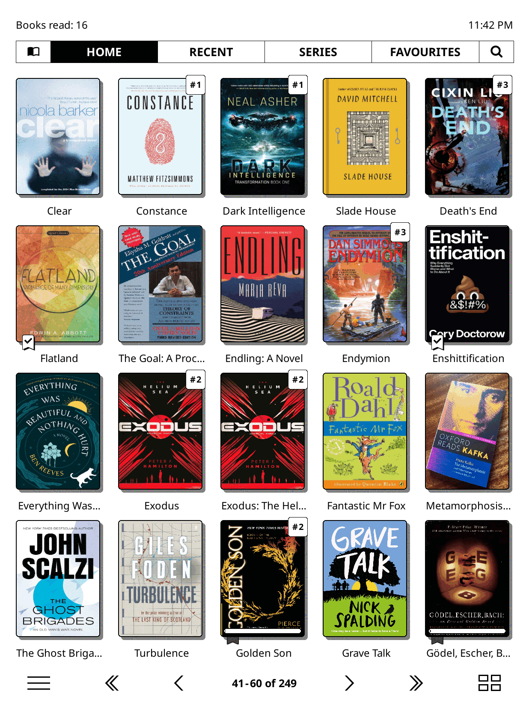
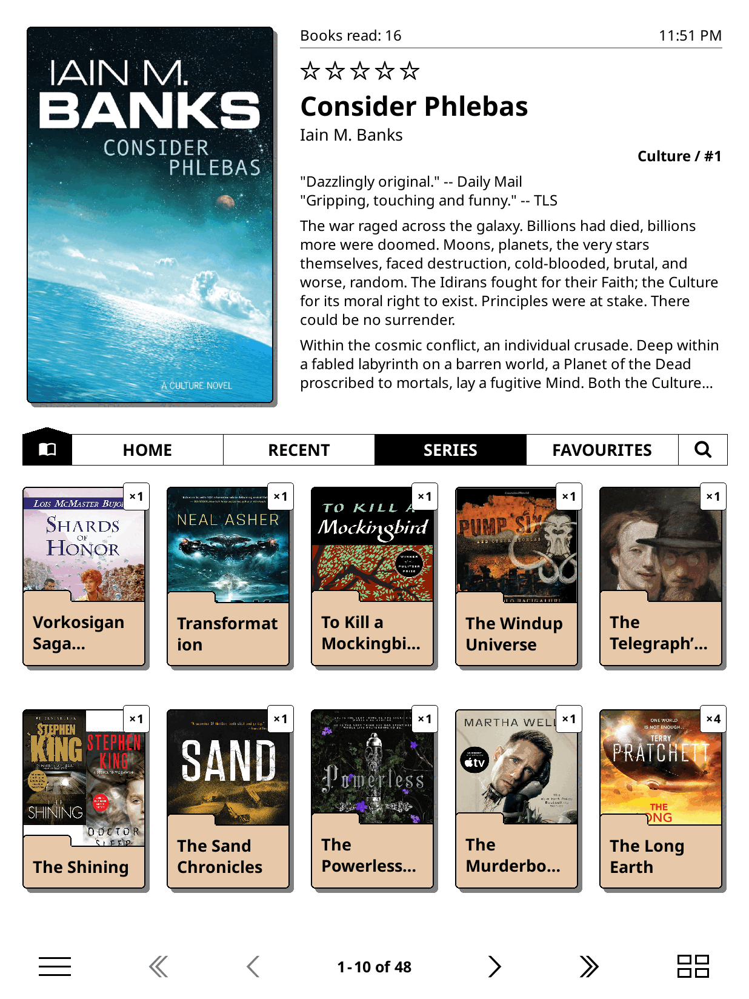
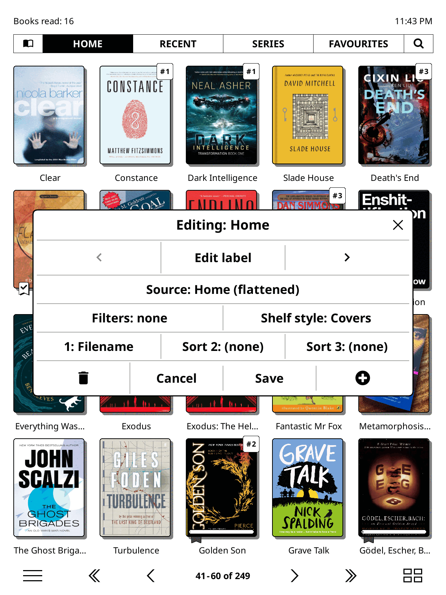
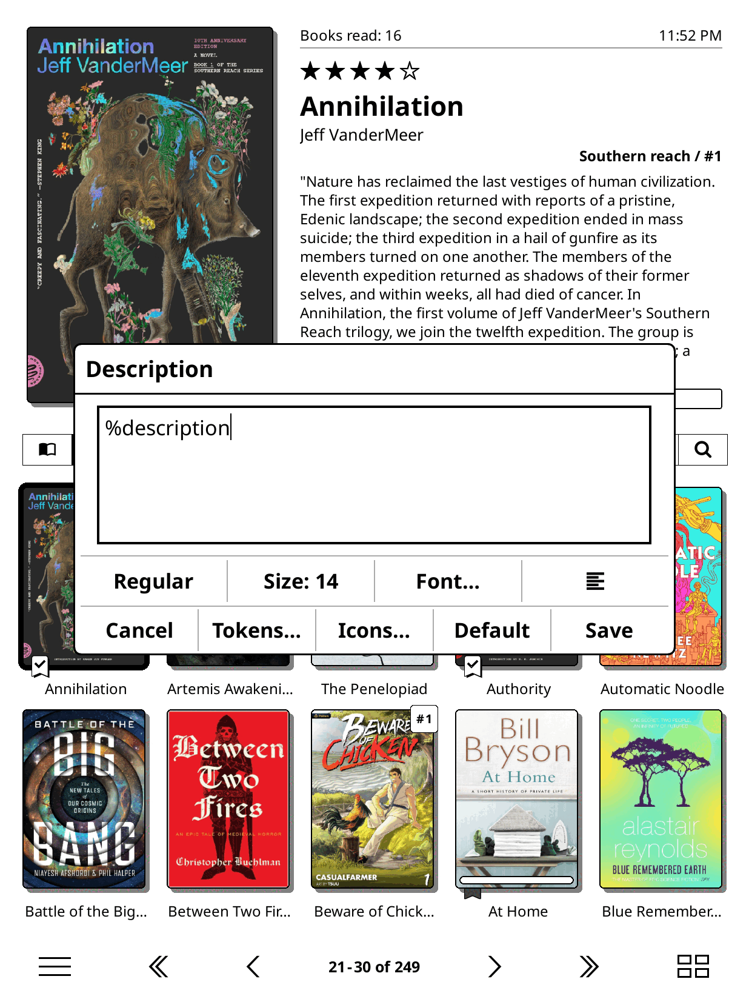
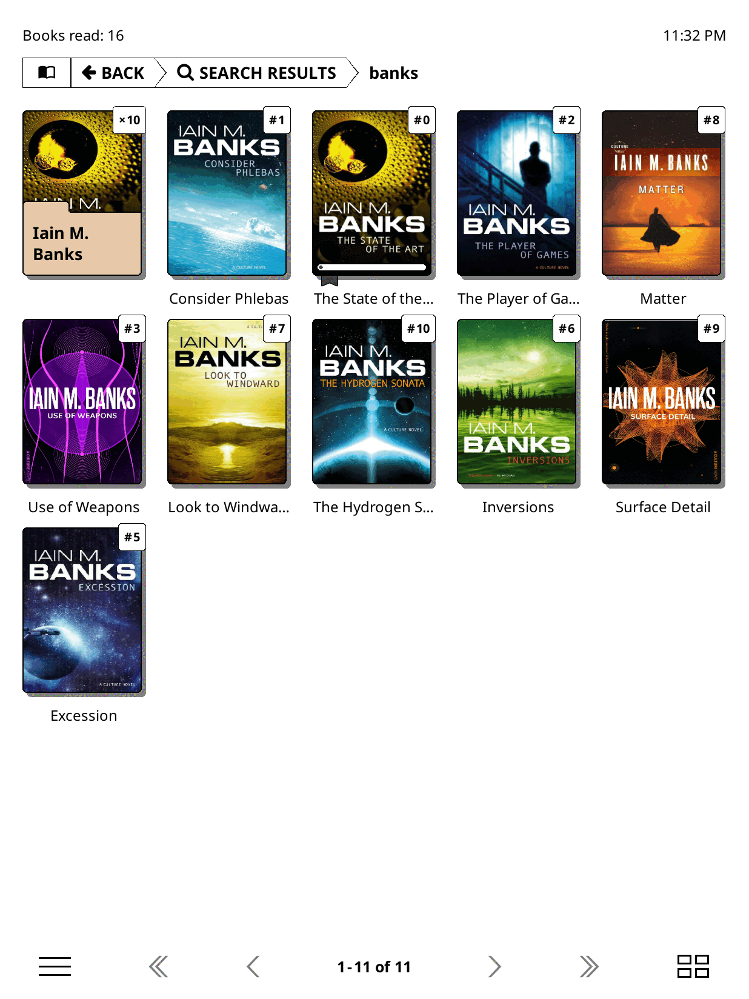

  <picture>
    <source media="(prefers-color-scheme: dark)" srcset="https://raw.githubusercontent.com/AndyHazz/bookshelf.koplugin/master/assets/bookshelf-logo-dark.png">
    
  </picture>

# Bookshelf

A friendly home screen for KOReader. Browse your library by series, author, genre, collection, or anything you like; pick a book, glance at its cover, blurb, rating and progress, and start reading. Shelves draw three ways: a grid of covers, a list, or spines standing edge-on like a real bookcase.

  
  
  
  
  

<b><a href="https://andyhazz.github.io/bookshelf-docs/">Read the user guide</a></b>: installing, every feature, every setting, with videos.

## Install

Bookshelf needs **KOReader v2025.08 or newer**, and works best on v2026.03 or newer (**Help > Version** in KOReader's menu). New to KOReader? The guide has [links to the official install guides](https://andyhazz.github.io/bookshelf-docs/get-started/koreader/) for every device.

1. Download **bookshelf.koplugin.zip** from [Releases](https://github.com/AndyHazz/bookshelf.koplugin/releases/latest) (not the green Code button).
2. Unzip it into KOReader's plugins folder:

   | Device | Plugins folder |
   |--------|----------------|
   | Kindle | `koreader/plugins/` |
   | Kobo | `.adds/koreader/plugins/` |
   | PocketBook | `applications/koreader/plugins/` |
   | Android | `koreader/plugins/` in internal storage |

3. Restart KOReader.
4. To open on your shelf every time: in KOReader's file browser menu, first tab, set **Start with** to **bookshelf**.

Bookshelf needs KOReader's **Cover browser** plugin, which is on in a normal KOReader. Updates install from inside KOReader: **Bookshelf > Updates**.

More detail, and what to do if it doesn't appear: [Install Bookshelf](https://andyhazz.github.io/bookshelf-docs/get-started/install/).

## The guide

| | |
|---|---|
| [**Get started**](https://andyhazz.github.io/bookshelf-docs/get-started/) | Install KOReader and Bookshelf, your home folder, opening on start-up, your first five minutes, and what changes if you know KOReader already. |
| [**Use your shelf**](https://andyhazz.github.io/bookshelf-docs/use/) | Covers, lists and spines; moving around; the book menu; search; the start menu. |
| [**Organise**](https://andyhazz.github.io/bookshelf-docs/organise/) | Shelves from any source, filters and sorts; series, authors, genres, folders and collections; page counts; Calibre, Kindle and Kobo libraries; online catalogues; Hardcover. |
| [**Make it yours**](https://andyhazz.github.io/bookshelf-docs/customise/) | Themes, wallpaper and colours, ornaments, theme packs, the top panel, micro-modules, layout and fonts. |
| [**Reference**](https://andyhazz.github.io/bookshelf-docs/reference/) | Every menu option, gestures, tokens, troubleshooting, updating, files and backup, what's new. |

## Theme packs

Ready-made looks for your shelf, with framed art, wallpapers, ornaments and new planks, are in the [Ko-fi shop](https://ko-fi.com/andyhazz/shop). Bookshelf itself is free and always will be; packs, or [a tip](https://ko-fi.com/andyhazz), are how you can support it.

## For plugin authors

Other plugins and user patches can add shelf sources, tokens, cover placeholders and OPDS actions, and anyone can write a micro-module. See [SOURCE_API.md](SOURCE_API.md), [micromodules/README.md](micromodules/README.md) and [For plugin authors](https://andyhazz.github.io/bookshelf-docs/reference/plugin-authors/).

## Help and feedback

Found a bug or have an idea? [Open an issue](https://github.com/AndyHazz/bookshelf.koplugin/issues). It helps to include your device, your KOReader version and Bookshelf's (**Bookshelf > About**).

## License

AGPL-3.0, see [LICENSE](LICENSE). The user guide is CC BY 4.0.

